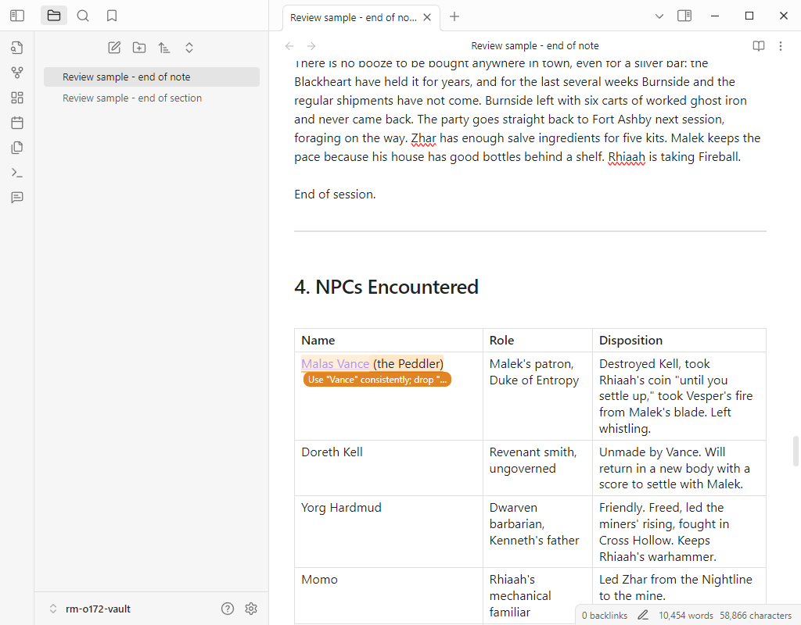
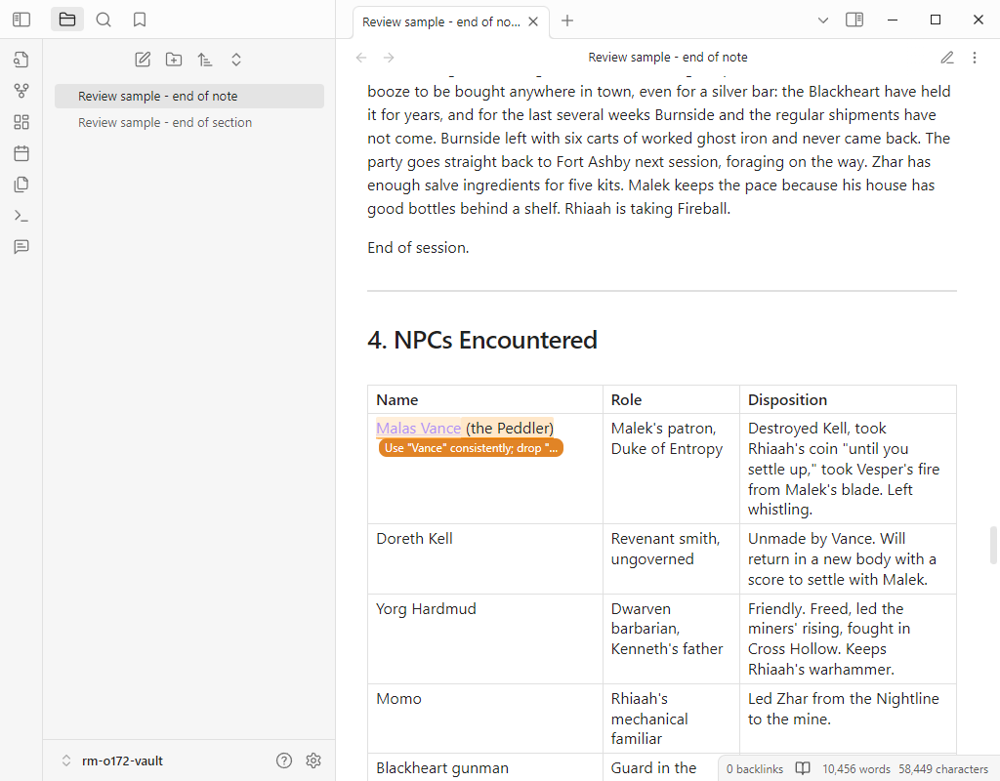
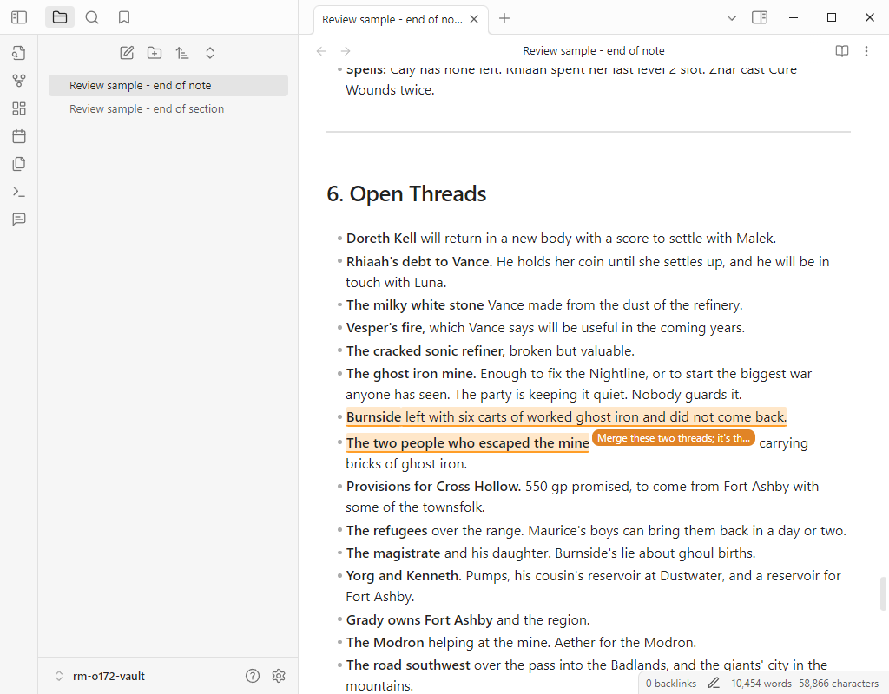
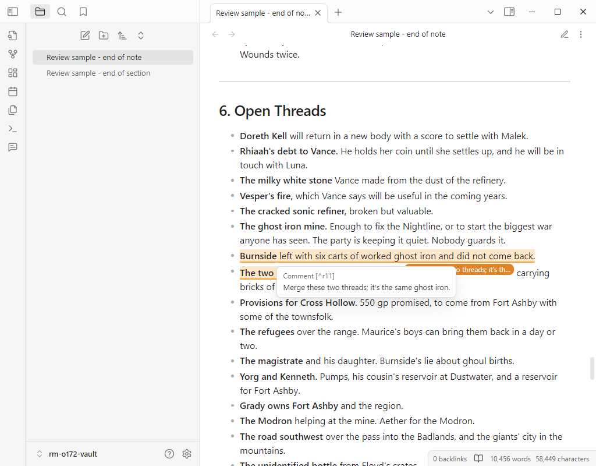

# Guarded APIs at Obsidian 1.7.x

Notes for issue #16. Checked 2026-10-30 against the prototype on `origin/prototype/storage-format` and the audit in `research/private-api-audit.md` (#13). The full result table is in the resolution comment on #16.

## What ran

- Obsidian 1.7.2 can't be downloaded. It was a Catalyst beta only. `desktop-releases.json` at commit `0dbff978db` points to `releases.obsidian.md/release/obsidian-1.7.2.asar.gz`, which now returns 404, and obsidian-releases has no v1.7.2 or v1.7.3 tag. I tested **1.7.4**, the first public 1.7 build, instead.
- I took the x64 app from the `Obsidian-1.7.4.exe` installer (Electron 31.6.0, Chrome 126) without installing it. It ran with its own `--user-data-dir`, `updateDisabled: true`, CDP on port 9411, and a temp copy of the prototype vault.
- For 1.8.10 and 1.9.14 I put `obsidian-<v>.asar` into the sandbox user-data dir, so the 1.7.4 loader picked it up. `ipcRenderer.sendSync('version')` confirmed each version. `navigator.userAgent` does not: it keeps reporting the installer version (1.7.4).

## Results at 1.7.4

Everything the audit marked "keep behind a guard" works. The prototype loads and draws r8 (a table cell) and r11 (spanning two list items) in both views:

| | Live Preview | Reading view |
|---|---|---|
| r8 |  |  |
| r11 |  |  |

One thing fails. `previewMode.renderer.sections` entries at 1.7.4 and 1.8.10 have `lineStart`/`lineEnd`. They have no `start.line`/`end.line`, which is what drag.ts reads. So Alt-drag in Reading view shows "Review Marks: the selection is not in the note text." When I shimmed `start`/`end` onto the entries, the same drag worked and switched to Live Preview. 1.9.14 has `start: {line, col, offset}` and the drag works without the shim. The change is somewhere in 1.8.11 to 1.9.14. I didn't bisect it.

`getSectionInfo` returned info for every post-processor section at 1.7.4 (h1-h3, p, ul, ol, table, hr, footnotes, blank). Replacing `renderer.sections` with `getSectionInfo` (audit item 2) therefore also removes the only 1.7.x failure.

## Sandbox side effect

On every launch, Obsidian calls `setAsDefaultProtocolClient('obsidian')`, which points `HKCU\Software\Classes\obsidian` at the sandbox exe. I exported that key before the first launch and imported it again after each launch. Do the same in any future sandbox run.
